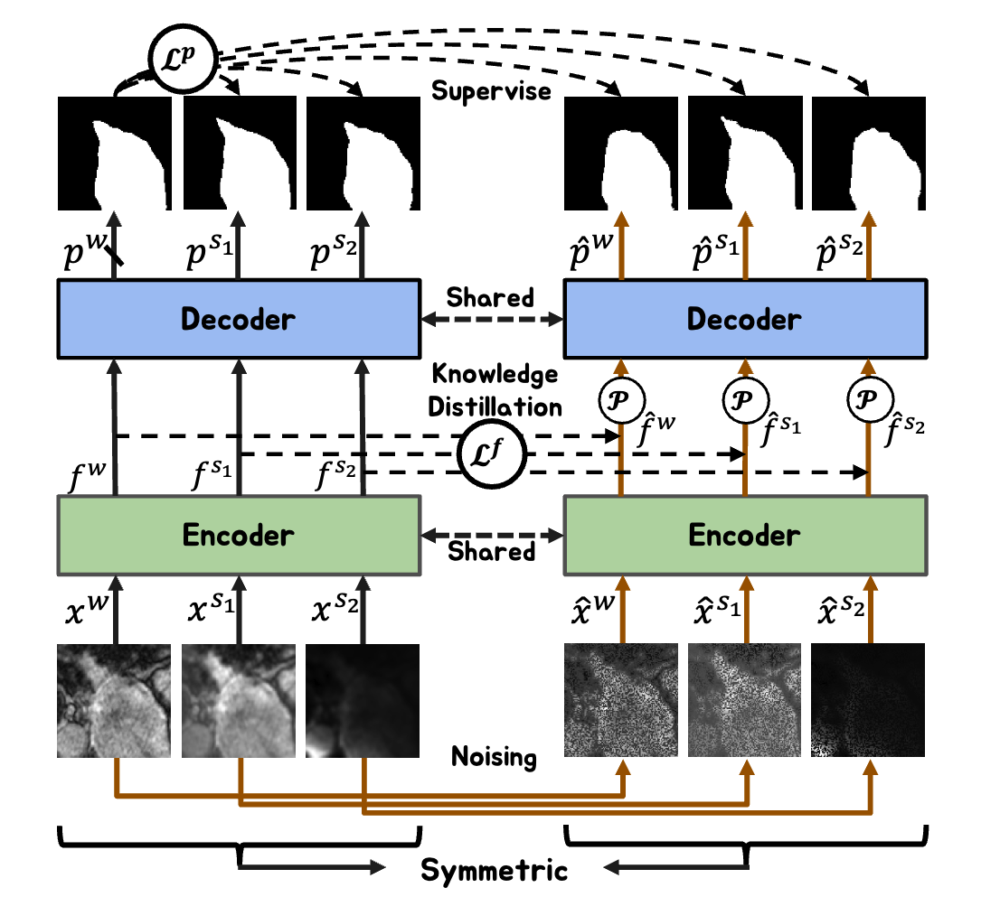
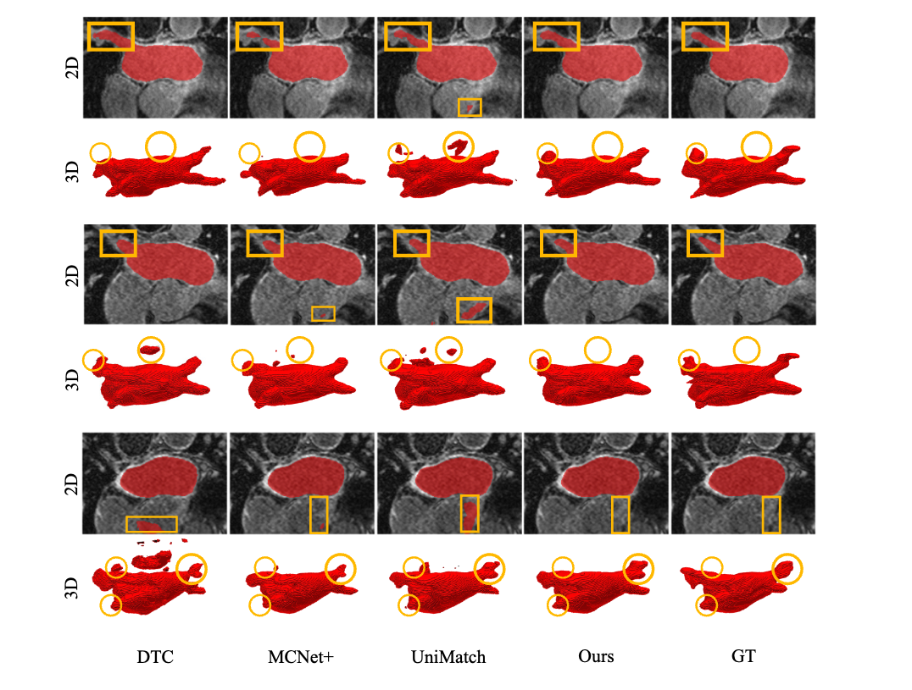

# SymMatch: Symmetric Bi-Scale Matching with Self-Knowledge Distillation in Semi-Supervised Medical Image Segmentation

[](LICENSE)
[](https://python.org)
[](https://pytorch.org)

This repository contains the official implementation of **SymMatch**, a novel semi-supervised medical image segmentation algorithm that leverages symmetric networks for knowledge distillation. Our method effectively utilizes limited labeled data along with abundant unlabeled data through a symmetrical network structure and bi-scale distillation techniques.

## 🔥 Highlights

- **Symmetric Architecture**: Derives dual networks from a single segmentation model using weight sharing
- **Bi-Scale Distillation**: Combines prediction-level and feature-level knowledge distillation
- **Multi-Level Perturbations**: Applies weak-to-strong perturbations at both image and feature levels
- **Superior Performance**: Achieves state-of-the-art results on multiple medical imaging datasets

## 📊 Method Overview



SymMatch introduces a consistency regularization framework based on perturbations and knowledge distillation. The method uses:

1. **Symmetric Dual Networks**: Teacher (left) and student (right) networks sharing the same weights
2. **Multi-Scale Perturbations**: Image-level and feature-level perturbations with varying strengths
3. **Bi-Scale Knowledge Distillation**: 
   - Prediction-level loss ($L^p$) for full-resolution supervision
   - Feature-level loss ($L^f$) for bottleneck feature distillation

## 🏆 Results



## 🚀 Getting Started

### Prerequisites

```bash
# Create conda environment
conda create -n symmatch python=3.8
conda activate symmatch

# Install dependencies
pip install -r requirements.txt
```

### One Click to Run

#### ACDC Dataset:
```python
cd ACDC
bash scripts/train.sh gpu_num port
# like `bash scripts/train.sh 3 12333` for 3 GPUs and port 12333
```

#### LA Dataset:
```python
cd LA/code
bash train.sh
```


## 📝 Citation

If you find this work useful for your research, please cite:

```bibtex
@inproceedings{wang2024symmatch,
  title={Symmatch: Symmetric bi-scale matching with self-knowledge distillation in semi-supervised medical image segmentation},
  author={Wang, Chunshi and Teng, Shougan and Sun, Shaohua and Zhao, Bin},
  booktitle={2024 IEEE International Conference on Bioinformatics and Biomedicine (BIBM)},
  pages={2562--2569},
  year={2024},
  organization={IEEE}
}
```

## 🙏 Acknowledgements

This code is adapted from several excellent repositories:
- [UA-MT](https://github.com/yulequan/UA-MT) - Mean Teacher framework
- [DTC](https://github.com/HiLab-git/DTC.git) - Dual-task consistency  
- [UniMatch](https://github.com/LiheYoung/UniMatch/tree/main/more-scenarios/medical) - Unified semi-supervised learning

We thank Lequan Yu, Xiangde Luo, and Lihe Yang for their elegant and efficient code bases.

## 📄 License

This project is licensed under the MIT License - see the [LICENSE](LICENSE) file for details.
